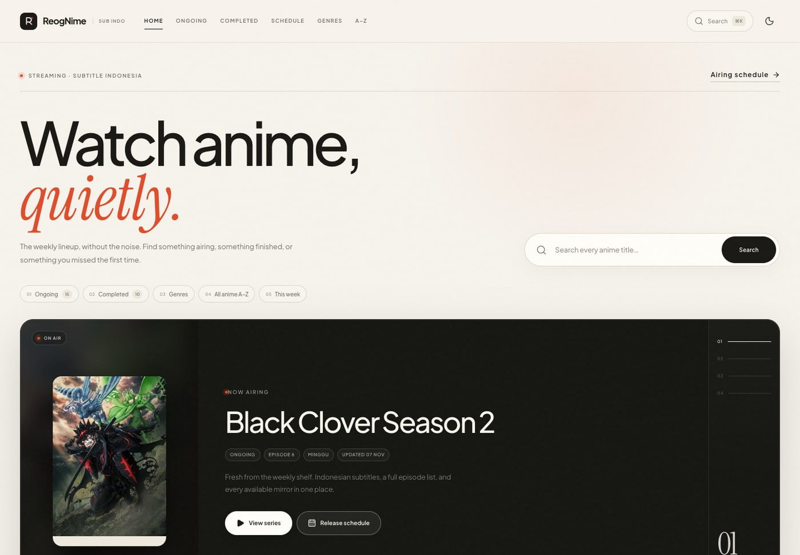
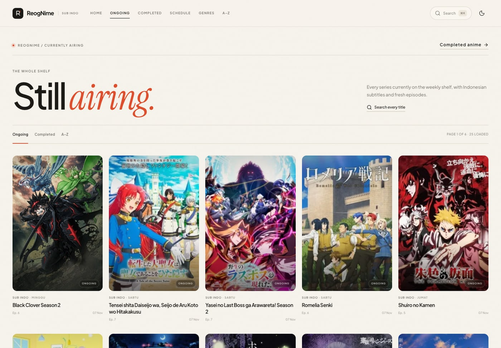
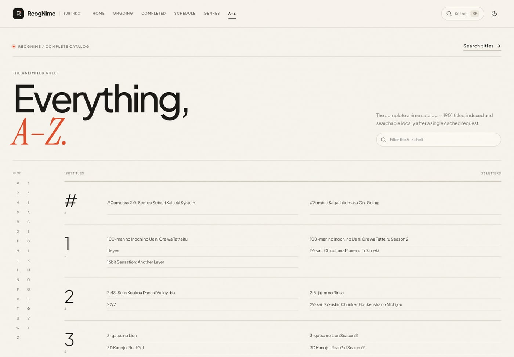
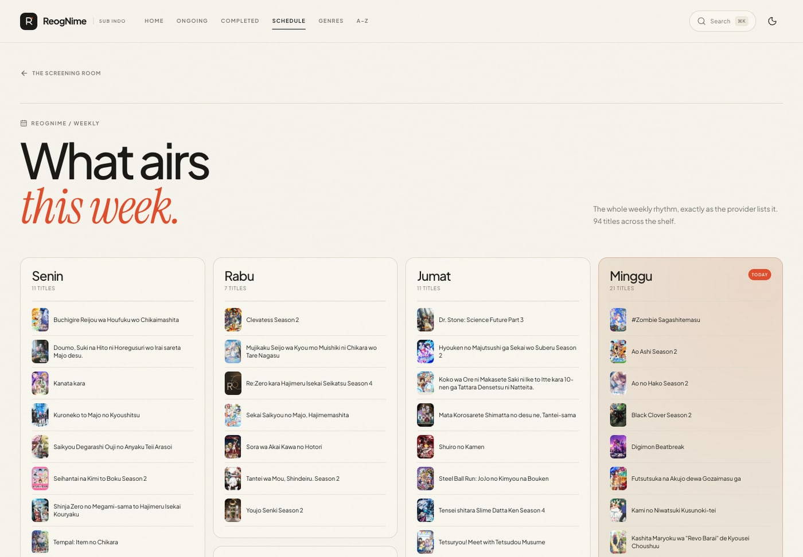
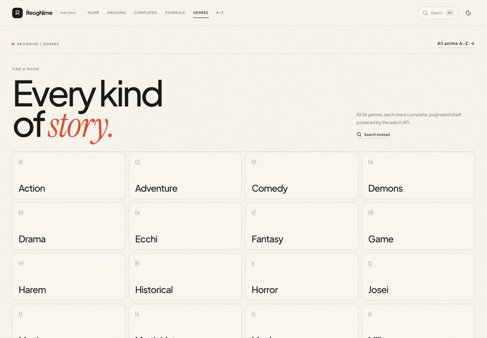
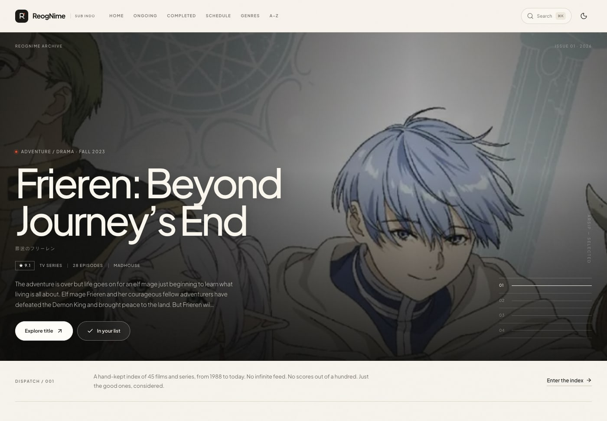
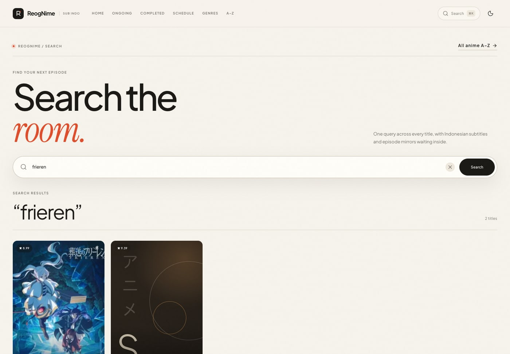
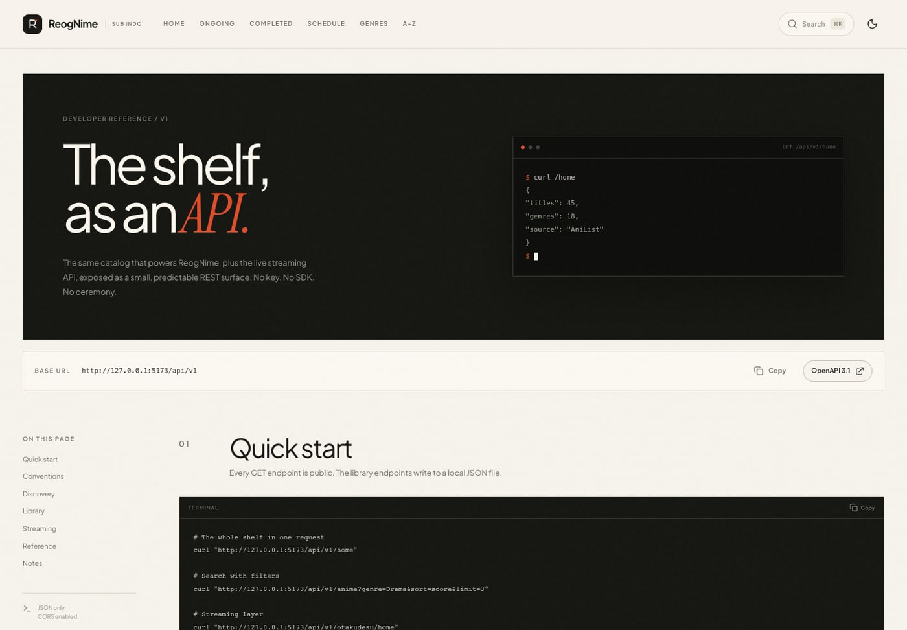

# ReogNime

**A quiet anime streaming room — powered end-to-end by the Otakudesu API, with a complete backend and an editorial archive.**

ReogNime now opens on the live Otakudesu lineup: ongoing, completed, A–Z, genres, search, weekly schedule, series detail, embedded mirrors and downloads. A second, quieter archive keeps the original AniList-powered discovery and personal library.



## What changed

The streaming API is no longer a side section. Every documented Otakudesu endpoint now has a real place in the interface:

| Otakudesu endpoint | ReogNime endpoint | Frontend surface |
| --- | --- | --- |
| `GET /anime/home` | `/api/v1/otakudesu/home` | Home `/` — featured ongoing + all ongoing/completed from the home feed |
| `GET /anime/ongoing-anime` | `/api/v1/otakudesu/ongoing` | Ongoing `/ongoing` — full pagination + home |
| `GET /anime/complete-anime` | `/api/v1/otakudesu/completed` | Completed `/completed` — full pagination + home |
| `GET /anime/schedule` | `/api/v1/otakudesu/schedule` | Airing schedule `/schedule` |
| `GET /anime/genre` | `/api/v1/otakudesu/genres` | Genre index `/genres` |
| `GET /anime/genre/:slug` | `/api/v1/otakudesu/genres/:slug` | Genre shelf `/genre/:slug` |
| `GET /anime/anime/:slug` | `/api/v1/otakudesu/anime/:slug` | Series detail `/watch/anime/:slug` |
| `GET /anime/episode/:slug` | `/api/v1/otakudesu/episode/:slug` | Player `/watch/episode/:slug` |
| `GET /anime/search/:keyword` | `/api/v1/otakudesu/search?q=` | Search `/search` + global command palette |
| `GET /anime/batch/:slug` | `/api/v1/otakudesu/batch/:slug` | Batch downloads inside series detail |
| `GET /anime/server/:serverId` | `/api/v1/otakudesu/server/:serverId` | Mirror resolution inside the player |
| `GET /anime/unlimited` | `/api/v1/otakudesu/unlimited` | Complete A–Z index `/all` |

The documented upstream home is `GET /anime/home`. A `/anime/homez` URL returns a 404 from the provider, so ReogNime uses the canonical `/home` endpoint.

## Screens

| Streaming home | Ongoing catalog |
| --- | --- |
|  |  |

| Complete A–Z index | Weekly schedule |
| --- | --- |
|  |  |

| Genre index | The ReogNime archive |
| --- | --- |
|  |  |

| Search | API reference |
| --- | --- |
|  |  |

## What’s inside

### Streaming frontend
- **API-backed home** built from the Otakudesu home feed, with an ongoing feature selector and the complete ongoing/completed lists.
- **Full catalog pages** for ongoing and completed titles, with paging that keeps loading from the provider.
- **Genre index and per-genre shelves**, all 36 genres.
- **A–Z index** over the complete `/unlimited` catalog — 1,900+ titles, filterable locally after one cached request.
- **Dedicated search** and a `⌘K` / `Ctrl K` command palette that both query Otakudesu directly.
- **Series pages** with synopsis, metadata, recommendations, episode list and lazy-loaded batch downloads.
- **Player pages** with quality/server selection, embed resolution, next/previous navigation, episode downloads, and safe fallbacks for offline or frame-blocked mirrors.
- **Airing schedule** grouped by day, with today highlighted.
- Auto-rotating hero, animated progress rails, a quiet title ticker, scroll reveals, soft card motion and page transitions.
- Light/dark themes, responsive layouts from 390px up.
- Self-hosted **Plus Ponorogo Sans** and **Instrument Serif** — no external font requests.

### The archive
- Original editorial homepage at `/archive` with AniList showcases, moods and a top-rated canon.
- Discovery index at `/discover` with search, formats, seasons, statuses and sorting.
- AniList title pages with cast, characters, related titles and episode tracker.
- Personal library at `/library` with statuses, scores, progress, notes, favourites, statistics, export and undo.
- The streaming navigation stays clean; archive links live in the footer.

### Backend
- Express 5 REST API under `/api/v1`.
- Normalized Otakudesu API under `/api/v1/otakudesu`; all responses wrapped in `{ data, meta }`.
- 30 upstream requests/minute hard guard (provider limit: 45), in-flight deduplication, stale-while-error cache, per-endpoint TTLs and a small cache cap.
- Artwork repair against the current Otakudesu sitemap, plus designed typographic fallbacks.
- Streaming URLs are sanitized; video is embedded from third-party mirrors and never proxied or stored.
- Zod validation, structured errors, CORS, Helmet, compression, request logging and OpenAPI 3.1.
- Local AniList archive API and persistent single-profile library.

### Stack
React 19 · TypeScript · Vite 8 · React Router 7 · Lucide · Express 5 · Zod 4 · Sharp · [Otakudesu API](https://www.sankavollerei.web.id/anime/) by Sanka Vollerei

## Quick start

Requires **Node 20.19+**.

```bash
npm install
npm run dev
```

| Service | URL |
| --- | --- |
| Web app | http://localhost:5173 |
| Streaming home | http://localhost:5173/ |
| Ongoing / Completed | http://localhost:5173/ongoing · `/completed` |
| Search | http://localhost:5173/search |
| REST API | http://localhost:8787/api/v1 |
| Otakudesu API | http://localhost:8787/api/v1/otakudesu/home |
| API docs | http://localhost:5173/developers |
| OpenAPI spec | http://localhost:8787/api/v1/openapi.json |

The Vite dev server proxies `/api` to Express. Express also serves `/media` for the local AniList archive assets.

### Production

```bash
npm run build
npm start
```

`npm start` serves the built SPA and API together on port `8787`.

### Deploy to Vercel

The repo is ready for Vercel: the SPA is built by Vite and the Express API runs as one function through [`api/index.js`](api/index.js). [`vercel.json`](vercel.json) wires the build, function and SPA fallback.

1. Push the repository to GitHub, GitLab, or Bitbucket.
2. Import it at [vercel.com/new](https://vercel.com/new). Keep the root directory as `.`; Vercel reads `vercel.json` (Vite, `npm run build`, `dist`).
3. Add optional environment variables in **Settings → Environment Variables**:
   - `CORS_ORIGIN` only if another origin will call the API.
   - `OTAKUDESU_API_BASE` / `OTAKUDESU_SITEMAP_URL` only if the provider moves.
   - Do **not** set `VITE_API_BASE_URL`; the browser uses the same-origin `/api/v1`.
4. Deploy. The API is available at `https://your-project.vercel.app/api/v1`, OpenAPI at `/api/v1/openapi.json`, and the UI at `/`.

With the CLI:

```bash
npx vercel --prod
```

To reproduce the Vercel environment locally (functions + SPA rewrites):

```bash
npx vercel dev --local
```

**Provider network note:** the public Otakudesu API sometimes returns HTTP 403 to datacenter IPs such as Vercel Functions. The SPA handles this automatically: if the server-side watch request fails, the visitor's browser fetches the public provider payload directly and posts it to `POST /api/v1/otakudesu/relay`, where the normal server normalizers (including artwork repair) run. The relay accepts only known endpoint names, has a 2 MB body limit, and is rate-limited. To disable this fallback, point `OTAKUDESU_API_BASE` at a reachable proxy or host the API where the provider is accessible.

**Vercel storage caveat:** the archive library is a single local JSON profile. On Vercel it is written to `/tmp/reognime-library.json`, seeded with the six demo entries on each fresh function instance. It resets on a cold start or redeploy. For a persistent personal library, point `LIBRARY_FILE` at a writable persistent volume or move `LibraryStore` to a database/KV; alternatively host the Express API on a persistent service and set `VITE_API_BASE_URL` to it. The in-memory upstream cache also resets with the function instance.

### Analytics & monitoring

Traffic tracking uses the public **Google Tag Manager** container `GTM-54X7Q2RH`, hardcoded in [`client/src/lib/analytics.ts`](client/src/lib/analytics.ts). No Vercel environment variable and no paid analytics plan is required.

The app:
- loads the GTM container in production;
- pushes a `page_view` dataLayer event on every React Router navigation;
- sends `page_title`, `page_location`, and `page_path`.

To finish the GA4 reporting setup in GTM:

1. Create/open the GA4 property and copy its **Measurement ID** (`G-XXXXXXXXXX`).
2. In GTM, add a **GA4 Configuration** tag with that Measurement ID and an Initialization/All Pages trigger.
3. Add three **Data Layer Variables**: `page_title`, `page_location`, `page_path`.
4. Add a **GA4 Event** tag named `page_view`, with those three parameters, triggered by the **Custom Event** `page_view`.
5. Submit and **Publish** the GTM container (saving alone is not enough).
6. Open GA4 → **Realtime** and navigate the site.

If the container already sends GA4 page views on All Pages, remove that duplicate page-view tag and use the custom `page_view` trigger instead; otherwise the first page may be counted twice. Vercel **Logs / Observability** remains the place to monitor API failures and function performance. GTM/GA4 is cookie-based and may require a consent notice; ad blockers can reduce reported traffic.

### A fresh archive list

The archive ships with six demo entries. To begin empty, remove `server/data/library.json` and restart the server; it recreates the file as an empty library. Streaming usage is stateless and is not stored in the library.

## Otakudesu API

All watch responses are normalized and cached. The global API rate limit is separate from the upstream guard.

| Method | Endpoint | Description |
| --- | --- | --- |
| `GET` | `/api/v1/otakudesu/home` | Ongoing + completed lists and a featured title |
| `GET` | `/api/v1/otakudesu/ongoing?page=1` | Paginated ongoing titles |
| `GET` | `/api/v1/otakudesu/completed?page=1` | Paginated completed titles |
| `GET` | `/api/v1/otakudesu/schedule` | Titles grouped by weekday |
| `GET` | `/api/v1/otakudesu/search?q=frieren` | Search titles |
| `GET` | `/api/v1/otakudesu/genres` | All 36 genres |
| `GET` | `/api/v1/otakudesu/genres/:slug?page=1` | Paginated genre shelf |
| `GET` | `/api/v1/otakudesu/anime/:slug` | Full series detail + episodes + recommendations |
| `GET` | `/api/v1/otakudesu/episode/:slug` | Episode, servers, downloads, prev/next |
| `GET` | `/api/v1/otakudesu/batch/:slug` | Batch qualities and mirrors |
| `GET` | `/api/v1/otakudesu/server/:serverId` | Resolve a mirror to an embed URL |
| `GET` | `/api/v1/otakudesu/unlimited` | Complete A–Z catalog |
| `GET` | `/api/v1/otakudesu/status` | Cache size and upstream quota state |

### Try it

```bash
# Home feed used by the actual homepage
curl http://localhost:8787/api/v1/otakudesu/home

# Current ongoing shelf, page 2
curl "http://localhost:8787/api/v1/otakudesu/ongoing?page=2"

# Search with a slash in the title
curl "http://localhost:8787/api/v1/otakudesu/search?q=Fate%2FZero"

# Resolve the series and then inspect an episode
curl http://localhost:8787/api/v1/otakudesu/anime/sousou-frieren-sub-indo
curl http://localhost:8787/api/v1/otakudesu/episode/snf-episode-1-sub-indo
```

The human-readable API reference lives at `/developers`; machine-readable OpenAPI is at `/api/v1/openapi.json`.

## The watch layer

A few details that make the integration behave:

- **Normalised data.** Upstream keys, marketing suffixes (`Subtitle Indonesia`, `(Episode 1 – 28)`) and inconsistent fields are cleaned into one stable model.
- **Home is the real home.** The root page consumes `/home` directly — not a separate mock list — and renders every ongoing/completed title it returns.
- **Image repair.** Legacy covers point at a Cloudflare-protected host. The server reads the current Otakudesu series sitemap and maps legacy filenames/titles to current WordPress CDN artwork. Unresolved covers become typographic posters.
- **Quota safety.** 30 upstream calls/minute, request deduplication, per-endpoint TTLs, stale fallback and a 220-entry cache.
- **Player mirrors.** Priority is `filedon` → `filelions` → `vidhide` → `mega`. Known frame-blocking `desustream` mirrors are never silently embedded; the player offers a new-tab fallback and a retry.
- **No video hosting.** ReogNime embeds third-party mirrors. It does not proxy, download or store video files.

### Known limitations

- Otakudesu is a third-party, unofficial provider. HTML/API/mirrors can change without notice.
- Images, episodes and embeddability can vary by region and mirror.
- The sitemap repair covers current/recent titles; older covers may fall back to typographic artwork.
- Provider quota is an in-process guard; use a shared limiter if you run multiple API instances.

## Archive API (AniList-powered)

The original archive API is still available for the `/archive`, `/discover`, `/anime/:id` and `/library` surfaces.

| Method | Endpoint | Description |
| --- | --- | --- |
| `GET` | `/api/v1/home` | Editorial archive home |
| `GET` | `/api/v1/anime` | Search/filter the 45-title archive |
| `GET` | `/api/v1/anime/:id` | Archive detail |
| `GET` | `/api/v1/anime/:id/episodes` | Episode index |
| `GET` | `/api/v1/anime/:id/related` | Related titles |
| `GET` | `/api/v1/search/suggestions` | Archive typeahead |
| `GET` | `/api/v1/random` | Random archive title |
| `GET` | `/api/v1/genres`, `/filters`, `/meta` | Reference data |
| `GET/POST` | `/api/v1/library` | Read/create personal archive list |
| `GET/PATCH/DELETE` | `/api/v1/library/:animeId` | Read/update/remove an entry |
| `GET` | `/api/v1/library/stats`, `/library/export` | Statistics and JSON export |

## Configuration

Copy `.env.example` and adjust as needed. Server variables are read at runtime; Vite variables are baked at build time.

| Variable | Default | Purpose |
| --- | --- | --- |
| `PORT` | `8787` | Express port |
| `HOST` | `0.0.0.0` | Bind address |
| `CORS_ORIGIN` | reflect request origin | Comma-separated allowed origins |
| `LIBRARY_FILE` | `server/data/library.json` (`/tmp/reognime-library.json` on Vercel) | Archive library file |
| `VITE_API_BASE_URL` | `/api/v1` | Frontend API base |
| `OTAKUDESU_API_BASE` | `https://www.sankavollerei.web.id/anime` | Public Otakudesu provider base |
| `OTAKUDESU_SITEMAP_URL` | `https://otakudesu.or.at/series-sitemap.xml` | Artwork repair sitemap |

## Project structure

```
.
├── api/
│   └── index.js             # single Vercel Function wrapping the Express app
├── client/
│   └── src/
│       ├── components/      # layout, Otaku cards/posters, command search, downloads, library dialog
│       ├── context/         # theme, toast, archive library state
│       ├── lib/             # API client, hooks, formatting, media helpers
│       ├── pages/           # home, ongoing/completed, genres, A–Z, search, schedule,
│       │                    # series, player, archive, discovery, library, API reference
│       └── styles.css       # complete design system
├── server/
│   ├── app.js               # Express factory and routes
│   ├── index.js             # server entry
│   ├── openapi.js           # OpenAPI 3.1 document
│   ├── routes/otakudesu.js  # normalized watch endpoints
│   ├── lib/otakudesu.js     # upstream client, cache, guard, image repair, normalizers
│   ├── lib/catalog.js       # archive catalog + search
│   ├── lib/library.js       # archive library store
│   ├── data/anime.json      # local AniList archive catalog
│   └── data/library.json    # archive library
├── public/media/            # local archive artwork
├── public/sitemap.xml       # generated SEO sitemap
├── public/robots.txt        # crawl rules
├── public/og-reognime.jpg   # social preview image
├── vercel.json              # Vercel build, function and SPA routing
└── docs/                    # screenshots
```

## SEO & Search Console

The site ships with the technical SEO basics:

- `public/robots.txt` allows public pages and points to the sitemap.
- `public/sitemap.xml` contains the static pages, genres, and all current streaming series.
- `client/index.html` has the canonical site description, Open Graph/Twitter cards, and `WebSite`/`Organization` JSON-LD.
- Each SPA route updates its `<title>`, description, canonical URL, Open Graph URL/image, and robots directive. Anime pages add `TVSeries` JSON-LD; episode pages add `TVEpisode`.
- `client/src/lib/seo.ts` is the single place for per-route and dynamic metadata.

### Submit to Google

1. Open [Google Search Console](https://search.google.com/search-console).
2. Add a **Domain** property for `reognime.site` (this covers both apex and `www`).
3. Google gives a DNS TXT record like `google-site-verification=...`. Add it in **Domainesia → DNS Management** as a `TXT` record with name `@`.
4. Verify, then submit `https://www.reognime.site/sitemap.xml`.
5. Use **URL Inspection** for `/`, `/ongoing`, and a few anime pages, then request indexing if they are not indexed.
6. After a few days, check **Performance → Queries/Pages** to see which keywords already bring impressions. Improve titles/descriptions around those queries.

Bing Webmaster Tools can import the site directly from Google Search Console.

### Refresh the sitemap

The sitemap is generated from the current provider catalog and committed as a static file, because Vercel Functions are blocked from fetching the provider:

```bash
npm run seo:sitemap
```

Run it when the catalog changes significantly, then commit `public/sitemap.xml`. It currently contains 1,946 URLs. The generator needs a network that can reach the Otakudesu API; your local Mac works.

### What “muncul di kolom pencarian” means

Google Autocomplete suggestions cannot be forced from a website. They follow query popularity and Google's own signals. Technical SEO gets pages indexed; to improve discoverability:

- Keep adding unique synopsis/episode content and update ongoing pages regularly.
- Use natural phrases such as “nonton anime sub indo”, “anime ongoing”, “jadwal anime”, and the actual anime title in titles/descriptions; avoid keyword stuffing.
- Build internal links between genres, anime, episode lists, and related recommendations.
- Share new pages on social media/forums and earn legitimate backlinks.
- Use Search Console queries to target titles that already receive impressions.
- Be patient: indexing can take days, and ranking/autocomplete takes weeks to months.

The metadata is applied client-side because this is a Vite SPA. Google renders JavaScript, but for maximum control over social previews and non-JS crawlers, the next step would be prerendering/SSR of the HTML routes.

## Tests

```bash
npm test        # 17 API, provider, relay, artwork, and Vercel-adapter tests
npm run typecheck
npm run build
```

## Design notes

- **Plus Ponorogo Sans** for interface and editorial display, with **Instrument Serif** italic accents. Both self-hosted.
- Warm paper, ink and vermilion palette with a soft gold secondary accent.
- Rounded poster cards and panel surfaces, hairline rules, generous negative space.
- The home page is alive without being loud: an auto-advancing featured pick (pauses on hover/focus), animated progress rails, a moving on-air ticker, staggered card entrances and scroll reveals.
- All motion respects `prefers-reduced-motion`; content remains fully visible without animation.
- AniList artwork enrichment upgrades streaming cards to high-resolution covers and wide hero banners, with provider artwork as the fallback.
- Dedicated typographic cover fallback so missing provider artwork never looks broken.
- Dark mode is a complete palette, not an inverted filter.
- Footer signature: **made by aldi with love**. The Otakudesu API data credit is intentionally retained.

## Security & scope

- The archive library API has **no authentication**. Put it behind auth before exposing it publicly.
- Streaming metadata is proxied; video streams are embedded from third-party hosts and are not stored or relayed by ReogNime.
- Provider quota guarding is in-memory and per-instance.
- Otakudesu data and video belong to their respective rights holders. Respect the provider’s terms and the rights of the works being linked.
- Archive metadata and artwork come from AniList; the same caveat applies.

---

Made by aldi with love. Set in Plus Ponorogo Sans & Instrument Serif.
